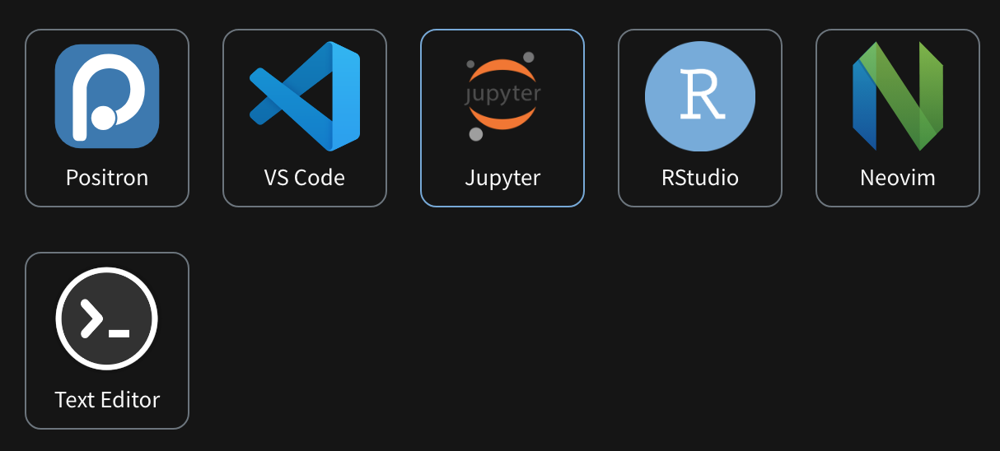

.. _quarto_startup:

=======================
Quarto快速起步
=======================

安装
=======

Quarto CLI提供了不同平台的安装软件包，这里我使用 :ref:`macos` 平台的 ``.pkg`` 安装包

使用
======

Quarto 提供了针对不同工具的集成，我重点关注 :ref:`jupyter` 和 :ref:`nvim` 的使用

Jupyter Lab
--------------

- :ref:`install_jupyter`

参考
=====

- `Quarto Get Started <https://quarto.org/docs/get-started/>`_
