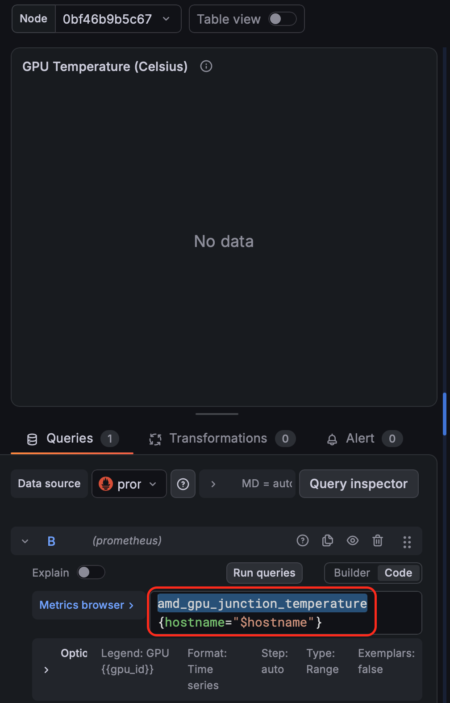
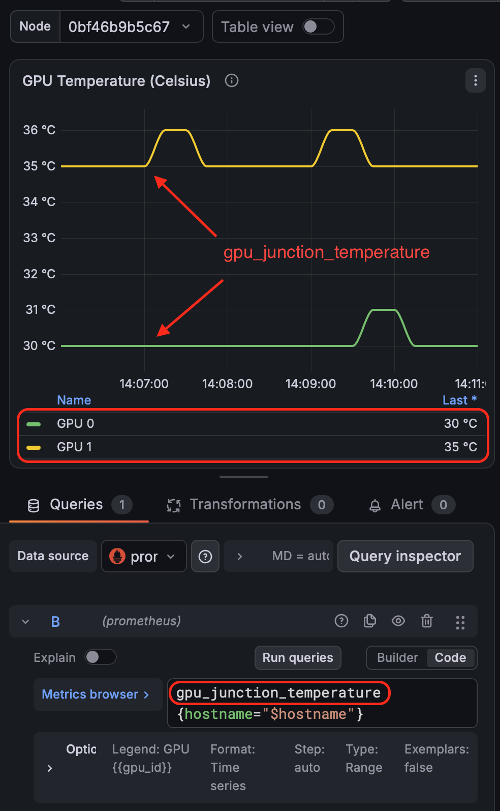

.. _amd_device-metrics-exporter:

=================================
AMD Device Metrics Exporter
=================================

.. _amd_smi_exporter:

AMD SMI Prometheus Exporter
=============================

AMD的 :ref:`amd_uprof` 不支持 :ref:`metrics` 输出，AMD公司开发了一个 `amd_smi_exporter (GitHub) <https://github.com/amd/amd_smi_exporter>`_ 采用SMI库信息输出。2025年，AMD SMI Prometheus Exporter项目宣布终止更新，迁移到 :ref:`amd_device-metrics-exporter`

AMD Device Metrics Exporter简介
================================

AMD Device Metrics Exporter提供以Prometheus格式从AMD GPUs实时采集遥感数据的功能。提供的完整metrics包括温度,使用率，内存使用率，功耗以及更多性能参数:

- Prometheus兼容metrics endpoint
- 丰富的GPU遥感数据包括:

  - 温度监控
  - 使用率metrics
  - 内存使用状态
  - 功耗数据
  - PCIe带宽metrics
  - 性能metrics

- 通过 :ref:`helm` chart集成到 :ref:`kubernetes`
- Slurm集成支持
- 可配置服务端口
- 容器化部署

部署
========

容器化部署
-------------

- 通过 :ref:`docker` 运行执行命令:

.. literalinclude:: amd_device-metrics-exporter/docker_run
   :caption: ``docker run`` 运行

可以看到在docker运行时要求:

  - ``--privileged`` 采用特权模式运行，所以在 :ref:`podman_compose_ollama_amd_mi50` 部署时， :ref:`podman` 需要采用 ``Rootful`` 模式运行并且也设置特权模式
  - ``--device=/dev/dri`` 和 ``--device=/dev/kfd`` 表示需要将这两个设备映射进容器提供给 ``device-metrics-exporter`` 访问
  - ``-v /sys:/sys:ro`` 表示需要将 ``/sys`` 文件系统提供给容器内的 ``device-metrics-exporter`` 读取性能数据

``podman compose``
~~~~~~~~~~~~~~~~~~~~~

在 :ref:`podman_compose_ollama_amd_mi50` 部署实践中，我采用了 ``podman compose`` 实现，其中关于 ``device-metrics-exporter`` 配置部分如下:

.. literalinclude:: amd_device-metrics-exporter/device-metrics-exporter.yml
   :language: yaml
   :caption: ``podman compose`` 的 ``device-metrics-exporter`` 配置

异常排查
==========

Grafana Dashboard
-------------------

在 :ref:`podman_compose_ollama_amd_mi50` 实践中尝试使用了:

- ``23434`` (较新): `AMD Instinct Single Node Dashboard <https://grafana.com/grafana/dashboards/23434-amd-instinct-single-node-dashboard/>`_
- ``18913`` : `AMD GPU Nodes <https://grafana.com/grafana/dashboards/18913-amd-gpu-nodes/>`_

但上述两个dashboard都没有显示出任何数据

命令行检查 ``Device Metrics Exporter`` 是否能正确输出metrics:

.. literalinclude:: amd_device-metrics-exporter/get_metrics
   :caption: 检查metrics输出

可以看到从 ``prometheus`` 容器角度出发是能够抓取 ``amdgpu-exporter`` 容器输出到Host主机 ``5000`` 端口上的 ``metrics`` ，至少从 ``prometheus`` 角度看是正常的。

从上述 ``检查metrics输出`` 可以看到终端输出metrics:

.. literalinclude:: amd_device-metrics-exporter/get_metrics_output
   :caption: 检查metrics输出内容

则在Prometheus的 ``Query`` 查询界面输入 ``pcie_rx`` 查询，就能够看到上述数据，这说明 ``prometheus`` 数据采集正常。如果要查询特定卡，例如GPU 1，则输入 ``pcie_rx{gpu_id="1"}``

晕倒: Grafana模板使用的并不是 ``device-metrics-exporter``
~~~~~~~~~~~~~~~~~~~~~~~~~~~~~~~~~~~~~~~~~~~~~~~~~~~~~~~~~~~~

我检查了 ``23434`` (较新) `AMD Instinct Single Node Dashboard <https://grafana.com/grafana/dashboards/23434-amd-instinct-single-node-dashboard/>`_ 的Query使用的根本不是 ``device-metrics-exporter`` :

- 检查 ``GPU Temperature`` 面板，其Query inspector可以看到是 ``amd_gpu_junction_temperature{hostname="$hostname"}`` ，但是在前面 ``检查metrics输出`` 看到的metrics变量根本没有 ``amd_gpu_junction_temperature`` ，而应该是 ``gpu_junction_temperature``

   默认 ``23434`` Dashboard 查询的是 ``amd_gpu_junction_temperature`` 和实际 **metrics不匹配** 导致没有数据

修改成 ``gpu_junction_temperature`` 变量进行查询，就会看到正确的数据曲线:

   修改 ``23434`` Dashboard 查询变量成为正确的 ``gpu_junction_temperature`` 就能正确获取数据

结合之前看到的 ``AMD SMI Prometheus Exporter`` 在2025年停止更新，更改为 ``AMD Device Metrics Exporter`` ，而上述 ``23434`` 面板实际上是2025年发布的。所以推测是该面板没有随着AMD公司更新Metrics Exporter而更新导致。

我通过下载 ``23434`` 面板的 ``.json`` 文件，修订 ``amd_gpu_`` 为 ``gou_`` 就可以看到很多采集面板正常显示

功率计算
~~~~~~~~~

**实时功率** : 从 ``metrics`` 输出中没有提供直接的 ``power`` 数值，但是有一个 ``gpu_energy_consumed`` 记录的是GPU 自启动以来累积消耗的能量（单位是微焦耳，μJ）。它是一个单调递增的计数器（Counter）。

**功率的物理定义是单位时间内的能量消耗** 所以需要根据上述 ``gpu_energy_consumed`` 计算: 

- GPU 0 实时功率: ``rate(gpu_energy_consumed{gpu_id="0"}[1m]) / 1000000``
- GPU 1 实时功率: ``rate(gpu_energy_consumed{gpu_id="1"}[1m]) / 1000000``

.. note::

   瓦特（Watt，简称瓦，符号为 W），定义为每秒钟做功 1 焦耳

   为何上述计算中没有除以60？答案是: ``rate()`` 内部已经包含了除以时间(秒)，计算时间窗口（1分钟）结束时的变量会自动除以60获得每秒的值。因为 **Prometheus 的 rate() 计算分母永远是“秒”（Seconds）**

原先配置是 ``gpu_package_power{hostname="$hostname"}`` 修订成:

.. literalinclude:: amd_device-metrics-exporter/power_query
   :caption: 查询主机的功耗

GPU带宽
~~~~~~~~~

计算公式:

.. literalinclude:: amd_device-metrics-exporter/pcie_rx_tx
   :caption: 计算rx/tx速率

这里不需要主动在PromQL里写 ``/1024/1024`` ，只保留原始的字节速率，然后让 Grafana 自己去智能缩放单位（会自动根据流量大小显示为 KB/s、MB/s 或 GB/s）

参考
======

- `AMD Device Metrics Exporter官方文档 <https://instinct.docs.amd.com/projects/device-metrics-exporter/en/latest/>`_
