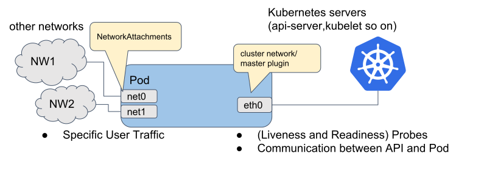

.. _multus:

====================
Multus CNI
====================

Multus CNI为Kubernetes的Pods提供了多网络接口功能，也就是Node上使用多个网络接口，分别提供public和data这样的不同功能，分别映射到容器内部以便实现数据分流。

工作原理
==========

Multus CNI是一个Kubernetes的容器网络接口(container network interface,CNI)插件以便能够实现将多个网络接口添加到容器内。通常，在Kubernetes中每个pod只有一个网络接口，而使用了Multus就能够创建具备多个网络接口的 ``multi-homed pod`` 。这个功能是通过Multus作为一个 "meta-plugin" 实现的。

通过Multus CNI，实现了一种采用配置附加网络接口的方式来提供标准化网络配置，该Multus项目是作为 Baremetal Container Experience Kit的项目

   Multi-Homed pod

参考
=====

- `Gighub: Multus-CNI <https://github.com/k8snetworkplumbingwg/multus-cni>`_
