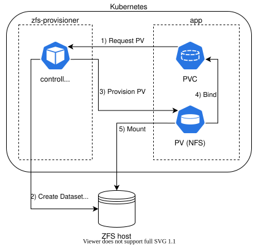
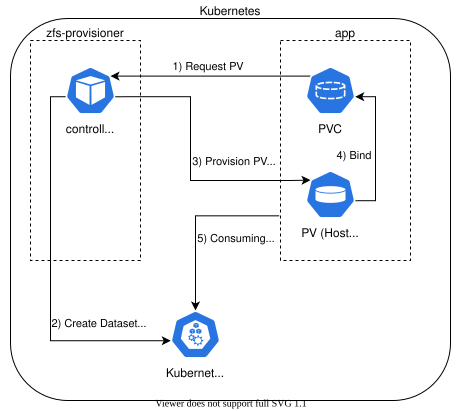

.. _k8s_zfs:

=======================
在Kubernetes中部署ZFS
=======================

kubernetes-zfs-provisioner
=============================

`kubernetes-zfs-provisioner <https://github.com/ccremer/kubernetes-zfs-provisioner>`_ 提供了一个动态 :ref:`zfs` 持久化卷provisioner。它的工作原理有两个方式:

- 通过 :ref:`ssh` 登录到远程服务器上创建ZFS datasets，然后通过 :ref:`k8s_nfs` 共享给Kubernetes挂载到pods中。

- ZFS主机本身是集群一部分时，则可能采用 :ref:`k8s_hostpath` 方式，但是此时需要采用 :ref:`k8s_nodeaffinity` 配置才能提供 ``PersistentVolume`` 对象

.. note::

   更为全面解决卷管理，也包括 :ref:`zfs` 的解决方案是 :ref:`openebs`

参考
======

- `kubernetes-zfs-provisioner <https://github.com/ccremer/kubernetes-zfs-provisioner>`_
