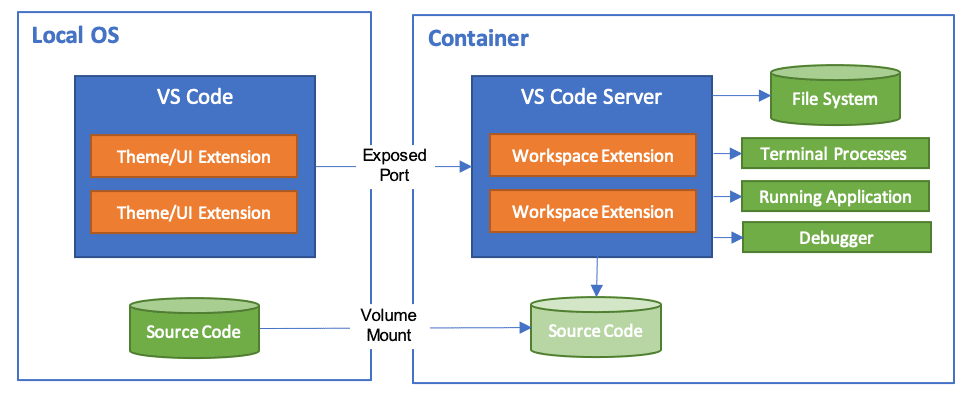
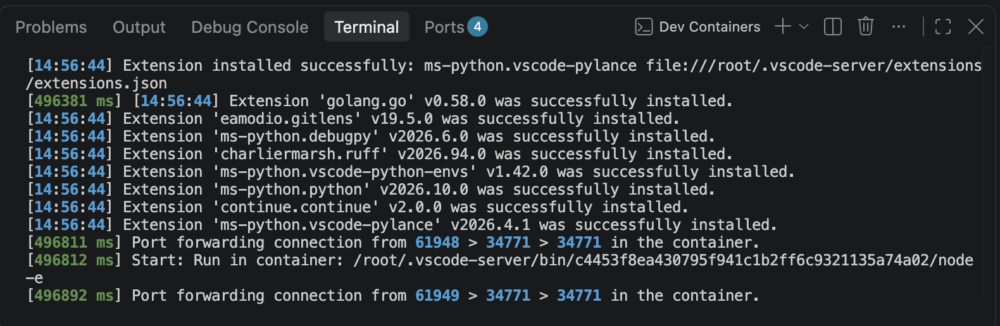
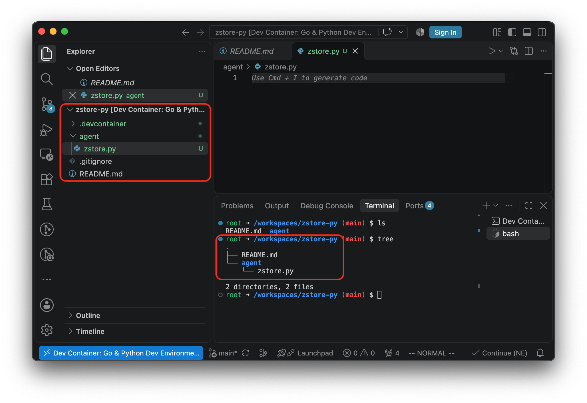

.. _vscode_remote_dev_containers:

===========================
VS Code远程开发-容器模式
===========================

在 VS Code 中， ``Dev Containers`` (开发容器) 是目前业界实现环境隔离、保证"在我的机器上能运行"到"在任何机器上都能完美复现"的终极方案。

Dev Containers 允许在 Docker 容器内部运行完整的开发环境（包含 Go 运行时、Python 虚拟环境、Poetry、Ruff、gopls 等所有工具链），而宿主机(如macOS)保持绝对干净。



准备工作
==========

- 确保 macOS 上安装并启动了 :ref:`docker_desktop` (或 :ref:`podman` / `Finch <https://runfinch.com>`_ 都是基于 :ref:`lima` 实现的轻量级虚拟机，finch实际上集成了 :ref:`nerdctl` 作为客户端 )

根据 ``Dev Containers`` 的Settings页面可以看到，该插件支持的客户端如下:

  - :ref:`docker`
  - :ref:`podman`
  - :ref:`nerdctl`
  - `Finch <https://runfinch.com>`_
  - WSLC (Windows only)

Docker可以本地，也可以远程安装。其他Docker兼容的CLI(没有官方支持)也可以本地或远程安装。

此外，VSCode也支持附加连接到一个运行中的容器( `VSCode Attach to a running container <https://code.visualstudio.com/docs/devcontainers/attach-container#_attach-to-a-container-in-a-kubernetes-cluster>`_ )，甚至可以连接到 :ref:`kubernetes` 集群中的一个容器。

.. note::

   我当前实践采用 :ref:`podman` Desktop

- 在 VS Code 插件市场搜索并安装官方插件: **Dev Containers** ( ``ms-vscode-remote.remote-containers`` )

项目目录结构
=============

- 在项目根目录下创建一个名为 ``.devcontainer`` 的隐藏目录:

.. literalinclude:: vscode_remote_dev_containers/dir
   :caption: 目录结构
   :emphasize-lines: 3,4

- 编写 ``.devcontainer/Dockerfile`` ，这里的案例是gemini提供的一个基于微软官方的通用开发镜像进行构建，仅作为案例测试，后续再调整成 :ref:`debian` :

.. literalinclude:: vscode_remote_dev_containers/Dockerfile
   :language: dockerfile
   :caption: Dockerfile基于微软官方通用发行镜像

- 编写 ``.devcontainer/devcontainer.json`` :

.. literalinclude:: vscode_remote_dev_containers/devcontainer.json
   :language: json
   :caption: devcontainer.json配置如何启动容器、安装插件和配置工作区

- 现在使用VSCode打开项目目录，应该就会自动检测到上述Docker配置文件，会自动提示你是否 ``Reopen in Container`` ；如果没有出现这个提示，则 按下快捷键 ``Cmd + Shift + P`` 打开命令面板，输入并选择: ``Dev Containers: Reopen in Container`` (在容器中重新打开)

  - 等待构建: :ref:`podman` (或 :ref:`docker` ) 会开始拉取基础镜像、执行 ``Dockerfile`` 并构建专属容器
  - 构建完成后: VS Code 左下角变成了绿色或蓝色标记(显示 ``Dev Container: Go & Python Dev Environment`` )

- 打开终端（ ``Ctrl + ``` ），此时的终端已经完全处于 Linux 容器内部:



不过首次显示的terminal是容器构建的日志信息，点击Terminal的右上角 ``+`` (或者快捷键 ``Ctrl + Shift +``` )重新开启一个终端窗口，就会看到容器内的熟悉的shell环境。现在任何在VS Code上创建的目录和文件实际上都是在远端容器内的Linux系统中完成，所以VSCode中显示的和Terminal(容器)中文件和目录结构都是一致的:



参考
========

- `Developing inside a Container <https://code.visualstudio.com/docs/remote/containers>`_
- gemini
