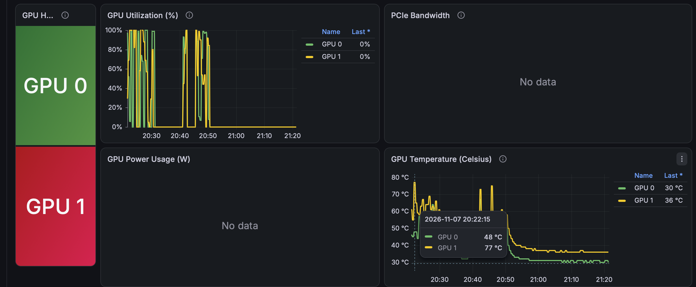
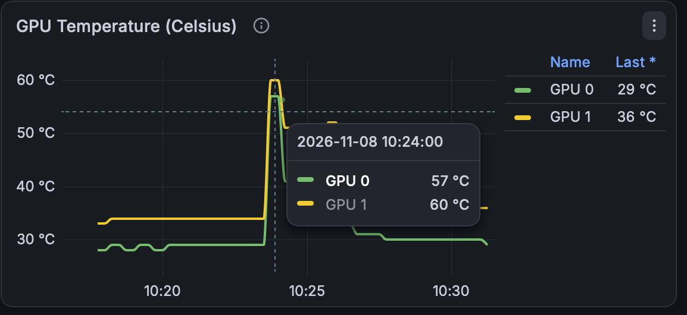

.. _amd_mi50_hardware_errors:

=============================
AMD MI50硬件报错
=============================

.. note::

   本文记录故障问题，待后续看是否持续出现或能否改善

目前在 :ref:`podman_compose_ollama_amd_mi50` 实践，采用了 :ref:`ollama_workqueue_optimize` 调整 :ref:`iommu` 之后，确实感觉卡顿和 ``workqueue`` 报错少了，但是却发现有硬件报错，集中在一块GPU上:

- 目前怀疑可能是散热不均匀或者功率问题导致一块卡存在功耗墙问题

.. literalinclude:: amd_mi50_hardware_errors/dmesg
   :caption: 硬件报错

.. warning::

   **严重硬件错误警报 (Uncorrectable Hardware Errors)**

   这组 dmesg 日志反映了一个非常严重且不能忽视的硬件级错误。日志中明确出现了 ``uncorrectable hardware errors detected in gfx block`` （图形/计算核心单元检测到不可纠正的硬件错误），这意味着 GPU 在执行大规模张量计算（大模型推理）时，其内部计算单元或缓存发生了数据损坏，且无法通过硬件 ECC 修复。

``uncorrectable hardware errors in gfx block`` : 在运行大模型推理时，其 Vega 20 核心的 GFX（图形与计算）管道、着色器阵列或 L2 缓存遇到了过载、电压不稳、频率过高或硅片老化导致的计算异常。

可嫩原因:

- (这条可能性较小，因为我刷 V420 Pro VBIOS文档中说明是降频和降低功率的) gemini 提醒可能有刷Pro VBIOS之后，核心频率或功耗墙被解锁。在 256K 超长上下文、双卡高带宽并行计算时，瞬时负载极高，可能超出了当前 VBIOS 固件下的电压安全边界。
- 供电瞬时压降（Power Droop）：Dell T5820 的电源供电或转接线在双卡满载时，如果供电瞬态响应跟不上，会导致 GPU 核心微幅掉压，从而引发硬件计算错误。
- 散热或积热问题：MI50 作为服务器/工作站级显卡，若改装风扇或风道散热不良，核心局部过热也会导致硬件单元抛出 ECC/RAS 错误。

目前我的GPU卡散热风扇转速是通过调节器手工调节，我为了降低噪音采用了较低的转速。由于是从主机硬盘供电转出的2个风扇工单，有可能两个风扇的散热转速不同。我准备通过手工调节转速加快风扇速度看看是否能解决。

   两块GPU的最高温度相差13度，可能存在散热异常问题

排查
=======

调整风扇转速
--------------

通过手动调整风扇转速(大约2/3最高转速，能听到明显风噪)，当GPU最高100%时，可以看到GPU温度确实下降了15+度以上，GPU1的最高温度只有60度非常理想:

   增加散热风扇抓速(大约2/3最高转速)最高GPU温度降低到60度(非常理想)

但是很不幸，依然发现 ``amdgpu 0000:b5:00.0`` 存在 ``uncorrectable hardware errors`` :

.. literalinclude:: amd_mi50_hardware_errors/dmesg_1
   :caption: 硬件依然报错
   :emphasize-lines: 3,5

我感觉 ``GPU1`` 是连接在南桥芯片上的 ``PCIe`` 接口，我想尝试更换插槽来看看情况

GPU互换PCIe槽
--------------

我尝试将GPU0和GPU1互换插槽，看看之前集中在 ``b5:00.0`` 位置的GPU1 ``uncorrectable hardware errors`` 是否会随着插槽变化迁移到另一个PCIe ``19:00.0`` 上。如果硬件报错确实随着GPU1换到另外一个 ``19:00.0`` 上，那么大概率就是硬件存在隐患(也许就是矿卡)。

有进展了:

互换了GPU插槽之后，还是出现了 ``uncorrectable hardware errors`` ，而且还是位于 ``b5:00.0`` 

.. literalinclude:: amd_mi50_hardware_errors/dmesg_2
   :caption: 硬件依然报错，而且固定在 ``b5:00.0``
   :emphasize-lines: 4,6

在 ``lspci`` 中显示在第一列的 ID( ``0000:b5:00.0`` )是严格绑定在主板的 PCIe 插槽 / 根端口（Root Port）拓扑上的，而不是绑定在显卡硬件设备本身。这次互换了 :ref:`amd_mi50` 物理为之后， ``b5:00.0`` 依然相同错误，证明:

:ref:`amd_mi50` 显卡芯片本身应该没有硬件问题，极有可能是主板的这个PCIe插槽( ``b5:00.0`` )、对应的PCIe通道(Lane)、或者该插槽的供电/信号完整性存在异常。

常见的硬件问题(gemini):

- **PCIe 信号完整性与毛刺(Jitter / Signal Integrity)** : 金手指接触不良、插槽内有微尘、或者 PCB 走线受到电磁干扰，会导致高频 PCIe 数据传输时出现位翻转（Bit Flip），GPU 的控制器误以为是计算核心（GFX block）发生了不可纠正的错误。
- **插槽供电瞬态异常(Power Rail Stability)** : PCIe 插槽不仅传输数据，还要提供高达 75W 的辅助供电。如果 ``b5:00.0`` 插槽对应的 motherboard 供电电路、MOSFET 或滤波电容存在微小老化或压降，当双卡高负载并发时，该插槽上的显卡会遭遇瞬间微掉压，导致计算单元（GFX block）抛出 3 个固定的硬件错误。
- **PCIe 速率协商过高** : MI50 是 PCIe 4.0 兼容设备，但在 T5820（Intel Xeon W-2235）上运行在 PCIe 3.0 模式下。如果该插槽的自动降级或信号握手不稳定，也会导致周期性的协议层报错。

我感觉上述第2条可能性较高，毕竟这个二手主机是7年前(2019年)生产的...

