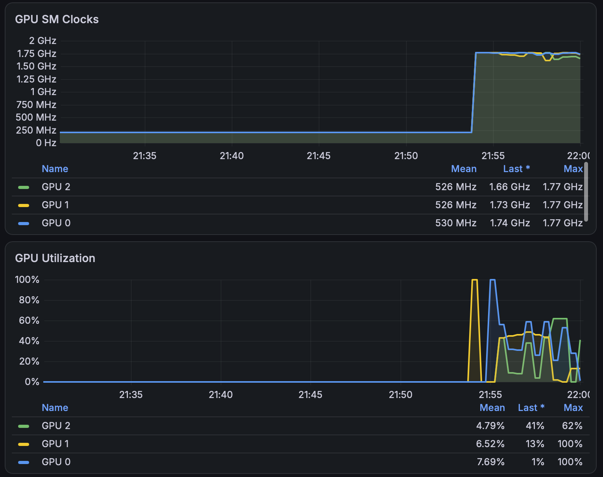

.. _tesla_a2_performance_health_monitor:

========================================
Tesla A2卡性能和健康的监控
========================================

我在 :ref:`podman_compose_ollama_nvidia_a2` 采用 :ref:`dcgm-exporter` 结合主机部署的 :ref:`nvidia_dcgm` 实现监控。通过 :ref:`grafana` 的 DCGM Exporter Dashboard(面板ID ``12239`` )观察到的一些性能和健康度:

   GPU SM Clocks(核心频率)满血1.73~1.77 GHz，但是GPU Utilization(利用率交替波动，均摊在 30%–60%)

性能
======

- ``podman logs -f ollama`` 观察日志可以看到 **在 3 块 NVIDIA Tesla A2 上运行 qwen3.8:27b-q8_0，平均 5.5 token/s 的生成速度**

LLM 推理（尤其是自回归逐字生成阶段）是典型的显存带宽受限（Memory-Bandwidth Bound）型任务：每生成 1 个 Token，显卡都必须把整个模型的权重从显存里完整读取一遍。

  - **Tesla A2 的显存带宽限制** : NVIDIA Tesla A2 定位为低功耗( ``40W–60W`` TDP)的边缘推理卡，单卡采用 ``128-bit GDDR6`` 显存，单卡显存带宽仅为 ``200 GB/s`` (对比之下，消费级 RTX 3090/4090 为 936–1008 GB/s)。
  - **理论速度测算** :

    - ``qwen3.8:27b-q8_0`` 的模型权重体积约为 29–30 GB
    - 在 Ollama 的默认多卡并行模式下（流水线并行 / Layer Split，而非张量并行），模型各层按顺序切分在 3 张卡上，同一时刻只有一张卡在执行当前层的显存读取，无法实现 3 倍带宽叠加。
    - 理论极限吞吐量: ``单卡带宽200GB每秒/模型大小30GB`` 大约是 6.6 token/s
    - 扣除层间跨 PCIe 传输激活值的通信开销以及 KV Cache 读写，实际稳定输出 5.5 token/s 已经达到了硬件理论上限的 83% 以上

  - 由于 :ref:`tesla_a2` 的显卡只能通过PCIe总线交换数据，PCIe的带宽和延迟远低于NVLink，所以Ollama默认的流水线平行(Pipeline Parallelism)虽然效率低，但是避免了PCIe传输中间张量的巨大延迟，所以还是适合 :ref:`tesla_a2` 的硬件环境的

- 监控上 GPU Utilization 始终不是 100%

  - **GPU SM Clocks(核心频率)** : 三张卡全部稳定拉满在 1.73–1.77 GHz 的满血睿频状态，说明显卡处于全速工作，没有任何功耗墙或温度降频。

  - **GPU Utilization(利用率交替波动，均摊在 30%–60%)** :

    - 原因 1（流水线串行接力）：Ollama（底层 llama.cpp）将 27B 模型的网络层均分到 GPU 0、GPU 1、GPU 2 上。推理时，数据流必须依次经过 ``GPU 0 → GPU 1 → GPU 2`` 接力计算。当 GPU 0 在算前几层时，GPU 1 和 GPU 2 必须空闲等待；因此单卡在一个完整 Token 周期内的时间片利用率自然在 33% 左右波动（在 21:54–21:55 处出现短时 100% 尖峰，正是 Prompt 预填充 Prefill 阶段的并行计算特征）。
    - 原因 2（Prometheus 抓取周期平均）：DCGM Exporter 默认每 5 秒或 15 秒采样一次，多卡接力产生的毫秒级脉冲在采样窗口内被平滑成了 30%–60% 的折线。

温度
========

我的 :ref:`podman_compose_ollama_nvidia_a2` 部署执行高负载进行大模型推理时，监控显示Tesla A2 显卡温度达到 79°C，咨询gemini如下:

- Tesla A2 温度区间参考

  - 待机状态 (Idle): 40°C ~ 50°C
  - 高负载推理状态 (LLM Load): 70°C ~ 82°C（属于常见的工作区间）
  - 降频保护阈值 (Thermal Slowdown): 通常在 85°C ~ 90°C 左右（超过此温度，GPU 会主动降低核心频率以防止硬件损坏）

- 可以通过终端快速检查显卡是否触发了温度降频保护(验证显卡是否健康运行)

.. literalinclude:: tesla_a2_performance_health_monitor/nvidia-smi_performance
   :caption: 检查 ``nvidia-smi`` 输出性能，观察是否出现温度降频保护

观察输出中是否存在 ``Slowdown`` 现象:

.. literalinclude:: tesla_a2_performance_health_monitor/nvidia-smi_performance_output
   :caption: 检查 ``nvidia-smi`` 是否存在 ``HW Thermal Slowdown``
   :emphasize-lines: 15

参考
======

- gemini
