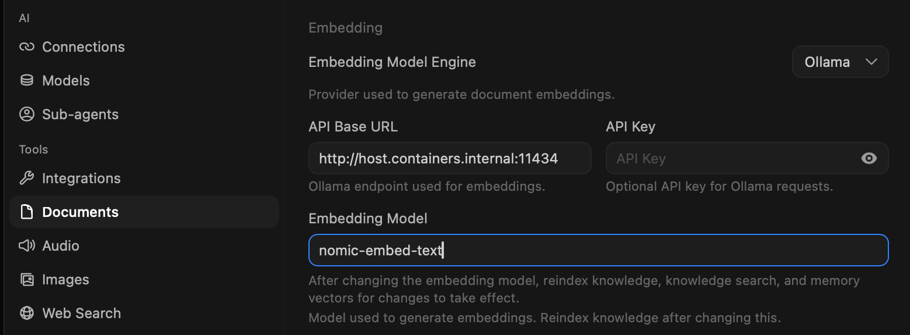

.. _open-webui_embedding_model:

==============================
open-webui 内嵌模型
==============================

在 ``Settings >> Tools >> Documents`` 设置部分，可以看到 ``open-webui`` 内置了一个 ``Embedding Model`` : ``sentence-transformers/all-MiniLM-L6-v2``

这个模型每次启动open-webui时会自动去连接 :ref:`hugging_face` 更新，所以如果主机不能翻墙则可能卡住无法启动 ``open-webui`` 容器。

按照gemini建议，可以调整为 ``nomic-embed-text`` (见 :ref:`podman_compose_ollama_nvidia_a2` )

- 修订 ``docker-compose.yml`` ，配置 ``open-webui`` 环境变量，指定通过ollama来访问RAG:

.. literalinclude:: podman_compose_ollama_nvidia_a2/rag.yml
   :caption: 修订 ``docker-compose.yml`` 指定open-webui使用Ollama的RAG
   :emphasize-lines: 12-14

- 在 ``open-webui`` 的 ``Settings >> Tools >> Documents`` 调整

   调整 ``open-webui`` 设置使用Ollama的 ``nomic-embed-text`` RAG模型
