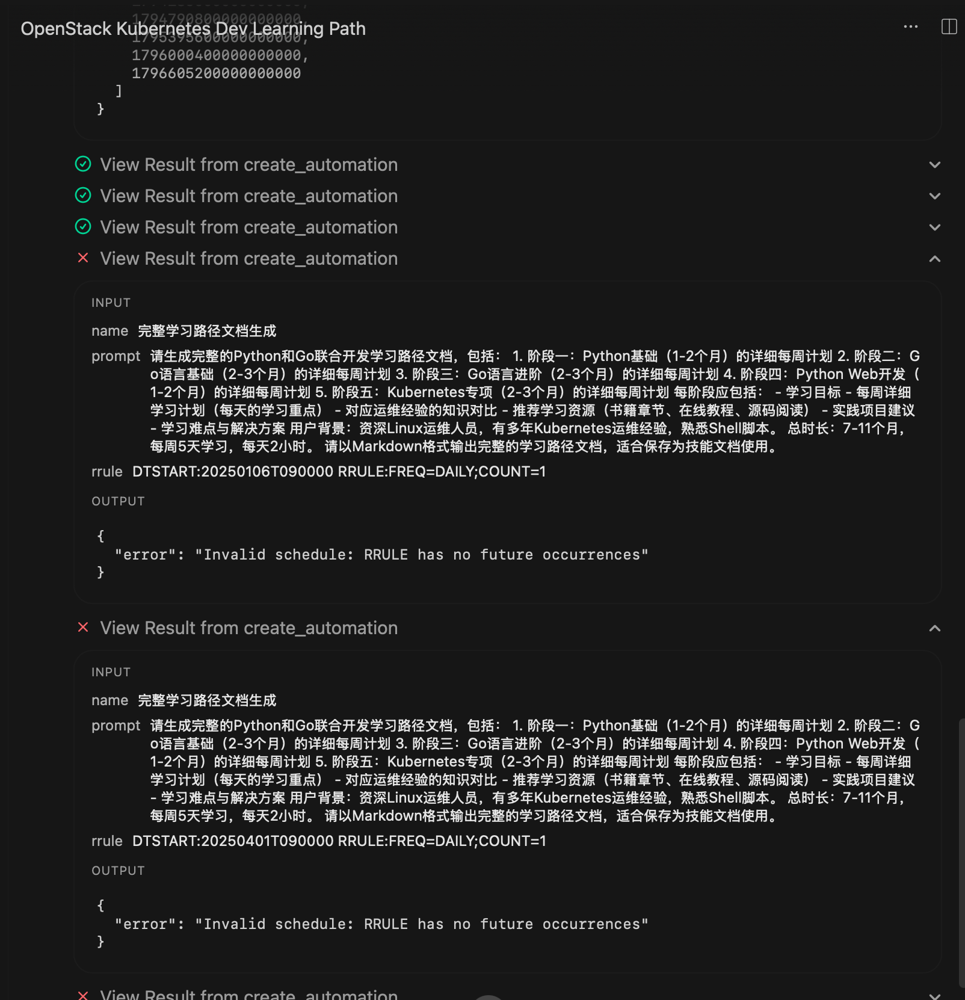
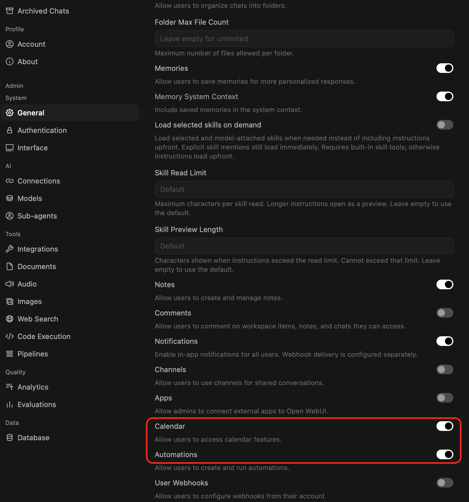

.. _open-webui_rrule:

==============================
``open-webui`` 的 RRULE 报错
==============================

我在 :ref:`ollama_init_tunning` 确实解决高负载下反复出现 ``page fault`` 报错，但是我又发现 ``open-webui`` 在推理过程中 ``create_automation`` 中反复出现相同的 ``RRULE`` 报错:

.. literalinclude:: open-webui_rrule/rrule_error
   :caption: 反复出现RRULE错误
   :emphasize-lines: 10

   反复出现RRULE报错，死循环

说明
=======

关键原因:

- 触发点：在提交任务时，后台附带了一个 rrule（iCalendar 重复规则）参数，例如: ``rrule DTSTART:20250106T090000 RRULE:FREQ=DAILY;COUNT=1``
- 核心原因：DTSTART 指定的时间（例如 2025 年 1 月或 4 月）以及 COUNT=1（仅执行一次且已过期的开始时间）在当前的系统时间（2026年11月）来看全部属于过去的时间。
- 校验失败：后台的调度解析器在计算这个重复规则时，发现它在未来没有任何可以执行的发生时间（ ``No future occurrences`` ），因此直接拦截并返回了该错误。

这里可以看到反复出现的 ``create_automation`` 工具这个关键字，那它在哪里?

调整
=======

在 ``open-webui`` 的 ``Settings >> System >> General`` 面板选项和上述现象有关:

- ``Automations`` : 开启后，系统允许后台创建和调度带循环规则(如 ``rrule`` )的任务。由于部分历史任务或默认工具模板带有过期的开始时间（如 2025 年），一旦触发就会导致后台校验失败并反复报错。将其关闭可以彻底切断这类无效的定时调度请求。

另外有一个 ``Calender`` 我感觉也用不上，一并关闭: 日常使用中完全不需要在大模型里管理日程或关联日历功能，以减少不必要的后台工具调用和接口开销。 

   关闭 ``Automations`` 和 ``Calender``

参考
=======

- gemini
