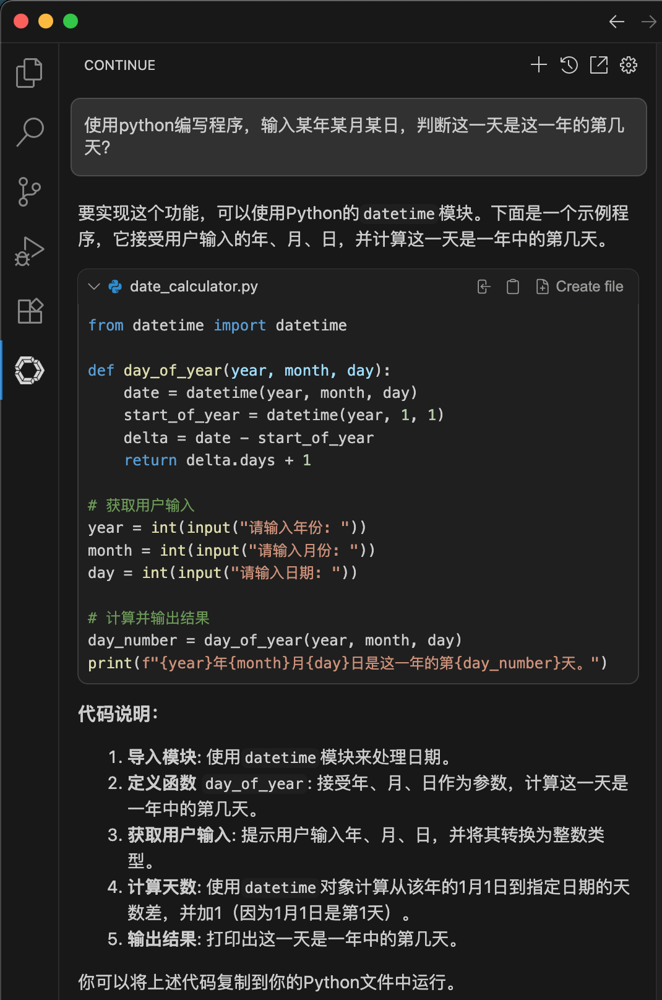

.. _vscode_continue_ollama:

===============================================
VS Code插件Continue连接Ollama实现AI辅助编程
===============================================

``Continue`` 插件为 :ref:`vscode` 提供了直接使用OpenAI作为AI编码后端的能力，同时也可以连接本地部署的大语言模型，实现完全自主控制的LLM大模型编程。

我在 :ref:`ollama_amd_gpu` 验证运行了 :ref:`qwen2.5-coder` 之后，尝试结合到 :ref:`vscode` 进行AI编程:

- ``Continue`` 提供了 chat 模式对话，以及自动补全和代码自动注释等功能，使用方便，无需频繁切换终端

硬件环境和规划
================

2026年初，我剁手了3块 :ref:`tesla_a2` ，此外在2025年剁手的 :ref:`amd_mi50` 以及更早的 :ref:`tesla_p10` ，形成了混合架构的GPU硬件。由于 :ref:`tesla_a2` 功耗极低，我准备在淘宝上购买涡轮静音风扇组装到我的台式机上，实现7x24小时持续运行的推理平台。另外也改造了 :ref:`tesla_p10` 增加了显卡散热风扇，一并安装到台式机上:

- 2块 :ref:`amd_mi50` 合计有64GB显存，GCN 5.1架构(古老)， ``HBM2`` 高性能内存具备惊人的 ``1.02TB/s`` 带宽，在 :ref:`podman_compose_ollama_amd_mi50` 使用 ``qwen3-coder-next:q4_K_M`` 能够稳定运行在 ``30 Tokens/s``
- 3块 :ref:`tesla_a2` 合计有48GB显存，Ampere架构，具备了第二代 Tensor Core，比 :ref:`tesla_p10` 先进了两个代际
- :ref:`tesla_p10` 24GB显存，Pascal架构，没有Tensor Core

规划通过安装 :ref:`nvidia_container_toolkit` 构建3个不同的容器构建"三引擎"AI工作站:

- 2块 :ref:`amd_mi50` (64GB显存):

  - ``qwen3-coder-next:q4_K_M`` 需要52GB显存，在 :ref:`dell_t5820` (PCIe 3.0)环境下双 :ref:`amd_mi50` (合计64GB)显存，实践设置 ``256K`` 上下文+ ``128`` batch，基本能够稳定输出 ``30 Tokens/s`` 满足个人开发使用

- 3块 :ref:`tesla_a2` (48GB显存):

  - ``qwen2.5-coder:32b-instruct-q4_K_M`` 需要20GB显存，对于双 :ref:`tesla_a2` (合计32GB)还能有12GB显存用于KV cache的上下文，支持约 16,384 到 24,576 tokens 的上下文长度（取决于是否开启了 GQA 优化），这样对于代码逻辑和架构设计会非常均衡

    - 负载均衡：Ollama 会自动将模型的 64 层（Layers）平均分配到两块 A2 上，每块卡负担约 32 层。这样每块卡的显存占用都在 14GB - 15GB 左右，处于非常健康的区间
    - 算力对齐：两块A2卡并行的总核心数（CUDA Cores）能让 32B 模型的推理速度维持在 10 - 15 tokens/s 左右。对于代码生成来说，这已经非常流畅（每秒能写 20-30 行代码）。

  - ``qwen3-coder:27b`` 多模态(Text,Image)需要18GB显存，能够有足够空间使用完整的 ``256K`` 上下文并运行其他小模型

- :ref:`tesla_p10` 相对性能较弱，不过内存有24GB是一个优势，考虑后续尝试作为项目代码分析(可能会比较慢)

安装和配置
=============

在 VS Code中选择插件市场，搜索 ``continue`` 并安装

- 打开VS Code，按下 ``Ctrl+Shift+P`` ，然后输入 ``Continue: Open Settings``
- 这里有一个界面是登陆 ``Coninue Hub`` ，不过也提供了另外一个选项是 ``Or, configure your own models`` ，我们就选择这个配置自己的模型
- 选择本地运行模型，让引导先生成一个配置模板，位于 ``~/.continue/config.yaml`` ，然后修订(采用 :ref:`podman_compose_ollama_amd_mi50` 和 :ref:`podman_compose_ollama_nvidia_a2` 部署的模型)

.. literalinclude:: vscode_continue_ollama/config.yaml
   :language: yaml
   :caption: ``~/.continue/config.yaml`` 配置本地模型

这里采用了2个服务器上部署的不同模型分别来提供 ``chat,edit,apply`` 和 ``autocomplete`` ，以充分发挥不同模型的优势

使用
========

- ``Continue`` 提供了一个chat模式，就好像直接和Ollama对话

  - 其实使用chat模式就很方便，通过简单对话就能获取代码片段进行参考，也方便学习编程
  - 代码注释比较有用，特别是看到一时无法理解的代码，让 continue 调用 Ollama 帮我解析，可以快速完成代码阅读

   对话模式通过提示获取代码片段

参考
========

- `How to Configure Ollama with Continue <https://docs.continue.dev/customize/model-providers/top-level/ollama>`_
- `Continue - open-source AI code assistant <https://marketplace.visualstudio.com/items?itemName=Continue.continue>`_
