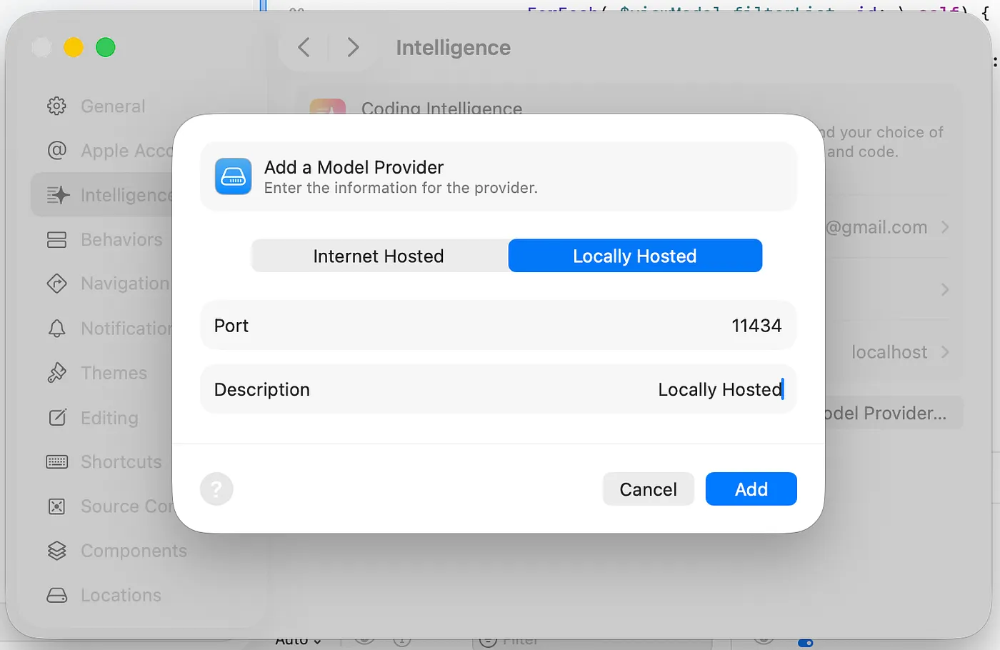

.. _xcode_ollama:

==========================
Xcode使用Ollama本地AI编程
==========================

2026年2月发布的Xcode 26.3，通过Model Context Protocol(MCP)提供了原生集成任何兼容模型。这个功能包括Anthropic的Claude Agent和OpenAI Codex，以及同一台Mac上全功能Ollama实例。也就是说，现在已经能够无需互联网连接使用本地私有部署AI编程辅助。Apple称这个发布释放了agentic coding的能力。

之前版本的Xcode只支持使用Apple提供的云端的以及有限的合作方的AI编程，但是从Xcode 26.3开始真正实现了MCP作为可操作层来使用本地Ollama模型。这个实现的重要意义在于能够在不同服务商之间切换。例如在进行探索性工作时可以使用云端模型，而在处理敏感的客户代码时则可以切换到本地Ollama模型，并且保持开发流程(IDE流程)不变，只是数据路径发生了变化。

设置方法
============

- 安装 Ollama 并至少拉取一个模型:

.. literalinclude:: xcode_ollama/pull
   :caption: 下载模型 ``qwen3-coder-next:4q_K_M`` (也可以选择其他模型)

- 在Xcode中使用菜单 ``Settings => Intelligence``

- 点击 ``Add Provider`` 并选择 ``Locally Hosted Model``

   本地模型设置(看起来只支持设置端口，那么默认就只有本地运行；当然也可以端口转发给远程服务器)

- 输入端口 ``11434`` (Ollama的默认本地端口)，并输入一个标签，并保存

参考
========

- `Xcode 26 + Ollama: Private Local AI Coding, No Cloud <https://www.freshlab.es/blog/xcode-ollama-local-ai-coding>`_
- `Supercharge Xcode 26 with Free, Local AI: A Practical Guide to Integrating Ollama <https://medium.com/@hiteshborse12/supercharge-xcode-26-with-free-local-ai-a-practical-guide-to-integrating-ollama-20e3c2ce43a7>`_ 比较详细的设置介绍
