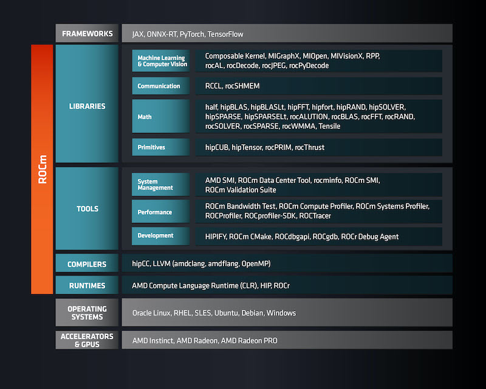

.. _intro_rocm:

====================
AMD ROCm简介
====================

AMD ROCm 是一个在AMD Instinct 加速卡和AMD Radeon GPU上运行HPC和AI工作负载实现兼容工业软件框架。

ROCm是一个软件堆栈，主要由开源软件构成，从底层内核到高层最终用户应用程序，提供了对AMD GPU的编程工具:

   AMD ROCm 软件堆栈

系统要求
==========

支持操作系统:

- Ubuntu 22.04 LTS (Jammy Jellyfish)
- Ubuntu 24.04 LTS (Noble Numbat)
- Ubuntu 26.04 LTS (Resolute Raccoon)
- RHEL 9.5(ROCm v1.1.0开始支持)

Docker兼容性:

- Docker 25.0+以上才支持所有功能
- Docker 28.3.0+以上才能使用标准化的 ``--gpus`` 参数来选择AMD GPUs
- 建议采用docker.io仓库或Docker官方仓库安装Docker
- 运行容器的用户必须位于 ``render`` 和 ``video`` 组

.. warning::

   **不支持Rootless mode** , AMD Container Runtime必须以root运行!

GPU分区:

- ROCm 6.4.1及以上才支持GPU partitioning
- 任何partitioning修改，都必须重新生成CDI spec来刷新GPU拓扑
- ``amd-smi`` 工具用于检查分区状态以及容器详情

参考
=======

- `AMD ROCm documentation <https://rocm.docs.amd.com/en/latest/>`_
- `What is ROCm? <https://rocm.docs.amd.com/en/latest/what-is-rocm.html>`_
